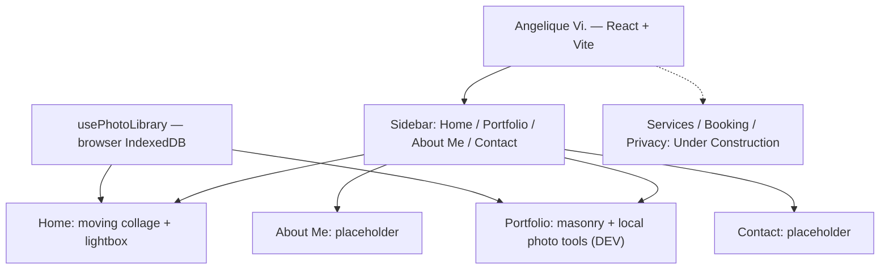
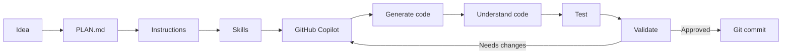

# Angelique Vi. — Photography Portfolio Plan

## Project goal

Build a modern photography portfolio that showcases the photographer's work, style, and personality. Services, photoshoot bookings, and an authenticated administration area are planned for later phases.

**Project language policy:** Keep GitHub documentation, code, comments, instructions, and current website content in **English**. Do not introduce Dutch UI copy yet. A user-selectable English/Dutch interface is a **planned feature**, described below, not an existing capability.

---

## Current implementation — local prototype

**Angelique Vi.** is the public brand. The frontend uses React, JavaScript, CSS, and Vite. There is **no ASP.NET Core backend, SQL database, secure admin account, or public photo storage yet**.

### Pages

- **Home** (`/`): moving photographic collage with arrow navigation and a clickable lightbox.
- **Portfolio** (`/portfolio`): static masonry gallery and local photo-management tools **only in Vite development mode**. Opening Portfolio photos in a lightbox is **not implemented yet**.
- **About Me** (`/about`): introductory text and portrait placeholder.
- **Contact** (`/contact`): placeholder text without real contact details.
- **Services**, **Booking**, and **Privacy**: under-construction routes without working functionality. The footer mentions these features. Social-media items are placeholders.

### Architecture

### Current gallery behavior

- Home builds collage columns dynamically from the available photos, with up to three images per column, and repeats them for a continuous loop.
- The gallery drifts slowly to the left by default. Two arrow buttons move it smoothly by roughly half a viewport width and set the subsequent drift direction. There is **no mouse-position steering or Pause/Play button**.
- Hover or keyboard focus enlarges a photo. Current scaling depends on the displayed card size (roughly **1.35×–1.9×**, limited to fit within the viewport); earlier scale values are no longer current.
- Clicking a photo on Home opens the lightbox with previous/next navigation, arrow keys, Escape, a close button, and backdrop click. Gallery movement pauses while the lightbox is open or a photo has keyboard focus.
- On touch devices or with `prefers-reduced-motion`, the gallery becomes horizontally scrollable without automatic movement.
- Production hosting must support an `index.html` fallback for direct navigation to paths such as `/portfolio`.

---

## Dynamic photo management — implemented as a local prototype

The former fixed set of 24 photo slots was replaced by **one dynamic photo collection** shared by Home and Portfolio.

### Present in the code

- `usePhotoLibrary.js` shares photos between pages; `photoStorage.js` stores original image files and metadata in **the current browser's IndexedDB**.
- `PhotoManager.jsx` is available **only on Portfolio when `import.meta.env.DEV` is true**. It supports adding multiple images, replacing or deleting individual images, and editing alt text.
- Supported uploads: JPEG, PNG, WebP, and AVIF, up to **15 MB per file**. Natural aspect ratios are read from images; extreme display ratios are capped for a usable layout.
- The frontend creates WebP thumbnails (up to 800 px wide) when possible; the full-screen viewer uses the original image.
- `collageLayout.js` builds columns dynamically. Portfolio uses the same collection in its masonry view.
- An empty library displays **12 demo placeholders**; real uploaded images replace the placeholder-only view.
- **No sync, server storage, or backup:** images are available only in that browser/storage context and may disappear if the browser's data is cleared. They are **not** automatically stored in GitHub or available on another computer.
- These editing tools are **not a secure admin interface**: there is no authentication or server-side authorization.

### Still to test or improve

- Browser-test adding 1, 5, and many images; deleting and replacing; refresh; empty state; image order; lightbox navigation; unusual ratios; oversized files; and mobile behavior.
- Visually review arrow usability, hover scaling, gallery density, responsiveness, and movement. Successful lint/build runs do not establish correct visual behavior.
- Consider enabling the lightbox on Portfolio as a separate improvement.
- Before public release, verify descriptive alt text, publication rights, identifying/location EXIF metadata, browser storage limitations, and performance with many images.
- Distinguish tested features from unverified assumptions in development reports.

### Later: real photo administration

Add secure administrator authentication, server-side permissions, durable image storage, SQL metadata, and safe upload processing via ASP.NET Core. **IndexedDB is only a local prototype, not the public upload backend.**

---

## Planned next feature — English/Dutch language selector

**Status: planned; not implemented.** Keep all development artifacts and default UI in English until this phase is explicitly started.

### Requirements

- Provide a small, accessible **EN / NL** language selector in the site navigation, on desktop and mobile.
- **English is the default language**; allow visitors to switch to Dutch without losing their place or current gallery/photo state.
- Translate all visitor-facing interface strings across Home, Portfolio, About Me, Contact, footer, navigation, lightbox, errors, and under-construction pages.
- Centralize translations in a simple, maintainable dictionary or equivalent structure instead of duplicating entire pages or scattering language checks throughout components.
- Remember the selected language locally (for example, in `localStorage`) and set the document language appropriately for accessibility.
- Preserve existing routes, keyboard accessibility, responsive layouts, and photo interactions.
- Photographer-provided descriptions/alt text require appropriate **human-authored translations** if localized; never silently machine-translate or invent original photo descriptions.
- No translation API, heavy localization library, new backend, or database unless the task justifies one.

### Acceptance criteria

- EN / NL selection works on desktop and mobile.
- Navigation, page content, interface controls, and modal labels switch consistently without a full-page reload.
- English is shown on the first visit; a visitor's selection survives refresh in the same browser.
- Routes and photos continue working after switching languages; no untranslated hardcoded UI copy is left behind.
- Verify keyboard access, screen-reader language metadata, build, lint, and browser behavior.

---

## AI development workflow

Before accepting AI-generated code, check: Does it compile? Does the requested behavior work? Is it safe and understandable? Can the developer explain the important changes?

---

## Security, privacy, and compliance

These are **design checkpoints**, not instructions to build every feature now, and not a declaration of legal compliance. Technical guidance is in `.github/instructions/security.instructions.md`.

### From version 1

- [ ] Secure baseline: no committed secrets, only necessary dependencies, safe input handling, and HTTPS for production.
- [ ] Host fonts locally; assess any external scripts, embeds, or requests to third parties.
- [ ] Do not enable analytics, tracking, or session replay by default; assess privacy implications and consent before adding them.
- [ ] Confirm image publication rights, especially for recognizable people and minors; consider EXIF and location metadata.
- [ ] Assess applicable privacy, cookie, and other legal notice requirements before publishing.

### Reassess when new features are introduced

- [ ] **Accounts:** determine if age is relevant and apply age/parental-consent protections when required; do not collect birthdates without a reason.
- [ ] **Contact and bookings:** collect only necessary customer information, validate server-side, and protect and retain data appropriately.
- [ ] **Newsletters/marketing email:** establish the legal basis, provide valid opt-in where required and a working unsubscribe method; distinguish booking confirmations.
- [ ] **Payments/subscriptions:** present the full price and any automatic renewal, billing interval, and cancellation terms before confirmation.
- [ ] **Photo uploads:** enforce safe file validation, authorization, and privacy protections.
- [ ] **DMCA/copyright procedures:** evaluate only if the service or user-submitted content makes them relevant; do not assume a US DMCA registration is necessary for a Belgian photography portfolio.

Recheck applicable Belgian/EU requirements when relevant features are implemented. Passing code checks does not establish legal compliance.

---

## Future enhancements

- Photographer services, prices, and packages
- Online booking, dates, availability, and confirmation emails
- ASP.NET Core backend, SQL database, and authenticated administration
- Persistent server-side photo library and gallery management
- Optional interactive 3D photo globe (not currently scheduled)
- Consider renaming `Portfolio` to `Gallery` later
