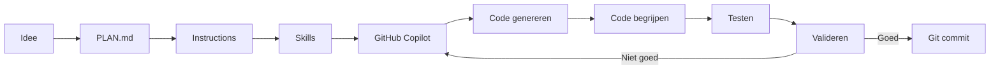

# Photography Portfolio

## Projectdoel

Een moderne portfolio-website voor een fotograaf.

De website moet in eerste instantie vooral het werk van de fotograaf tonen en bezoekers kennis laten maken met haar stijl en persoonlijkheid.

Later wordt de website uitgebreid met diensten en een reservatiesysteem voor fotoshoots.

---

## Versie 1

### Actieve pagina's

- Home (`/`): grote bewegende fotogalerij
- Portfolio (`/portfolio`): statische masonry fotogalerij
- About Me (`/about`): korte introductie van de fotograaf
- Contact (`/contact`): contactpagina

### Under Construction

Deze pagina's worden al voorzien in de structuur, maar zijn voorlopig niet actief:

- Services
- Booking / Reservatie
- Privacy

---

## Website structuur

```mermaid
flowchart TB

    SITE["📷 Photography Portfolio"]

    NAV["Zijbalknavigatie links"]

    NAV --> HOME["Home"]
    NAV --> PORTFOLIO["Portfolio"]
    NAV --> ABOUT["About Me"]
    NAV --> CONTACT["Contact"]
    NAV --> SERVICES["Services"]

    subgraph HOME_CONTENT["Home"]
        HERO["Bewegende fotogalerij in meerdere rijen, rechts naar links"]
        GALLERY["Muis bepaalt richting en snelheid (stilstand in het midden); buiten de galerij rustig verder in de laatste richting (standaard van rechts naar links); lichte zoom (1,18); lightbox met vorige/volgende, pijltjestoetsen, Escape, sluitknop en lus"]
        INTRO["Pauze/play-knop en rustige weergave bij verminderde beweging"]
        FEATURED["Touch: horizontaal scrollen zonder hover"]
        SOCIAL_PREVIEW["Social media in de zijbalk, placeholders"]
    end

    HOME --> HERO
    HOME --> GALLERY
    HOME --> INTRO
    HOME --> FEATURED
    HOME --> SOCIAL_PREVIEW

    subgraph PORTFOLIO_CONTENT["Portfolio"]
        ALLPHOTOS["Statische masonry fotogalerij"]
        CATEGORIES["Categorieën / collecties"]
        PHOTO_DETAIL["Foto's groter bekijken"]
    end

    PORTFOLIO --> ALLPHOTOS
    PORTFOLIO --> CATEGORIES
    PORTFOLIO --> PHOTO_DETAIL

    subgraph ABOUT_CONTENT["About Me"]
        ABOUTPHOTO["Foto van fotograaf met camera"]
        STORY["Persoonlijk verhaal"]
        STYLE["Stijl & werkwijze"]
    end

    ABOUT --> ABOUTPHOTO
    ABOUT --> STORY
    ABOUT --> STYLE

    CONTACT --> SOCIALS["Social media / contactgegevens"]

    subgraph FUTURE["Under Construction"]
        SERVICES
        BOOKING["Booking / Reservatie"]
        PRIVACY["Privacy"]
    end

    SERVICES --> SHOOTS["Soorten fotoshoots"]
    SERVICES --> INFO["Beschrijving"]
    SERVICES --> PRICES["Prijs / vanafprijs"]

    SERVICES -. "Boek een fotoshoot" .-> BOOKING
    SITE -. "Footer" .-> PRIVACY
```

---

## Homepage en routes

- De homepage bestaat vooral uit een grote, continu bewegende, organische fotocollage (kolommen met staande, hoge, vierkante, liggende en brede foto's op wisselende hoogtes, ongeveer 10 px tussenruimte, weinig lege ruimte).
- Alles beweegt traag en rustig van rechts naar links, in een naadloze lus. Eén gedeelde snelheidsregeling (requestAnimationFrame) zorgt dat de beweging zacht afremt tot stilstand (ongeveer 900 ms) en weer versnelt, zonder sprongen.
- Hover of toetsenbordfocus pauzeert de galerij; na ongeveer 200 ms
- Er is een zichtbare pauze/play-knop. Bij `prefers-reduced-motion` en op touchapparaten is er geen automatische beweging maar een rustig, horizontaal scrollbare weergave.
- De pagina's Home, Portfolio, About Me en Contact hebben elk een eigen route. Services, Booking en Privacy blijven Under Construction.
- Foto's komen voorlopig uit één gegevensbestand met placeholders. De volgende lokale ontwikkelfase maakt het aantal foto's dynamisch, met automatisch bepaalde afmetingen en eigen fotobestanden.
- Onderaan elke pagina staat een footer met scheidingslijn: links "Services, Booking and Privacy: Under Construction", rechts "Angelique Vi.".
- Bij publicatie moet de hosting onbekende paden doorsturen naar `index.html`, zodat een directe refresh van bijvoorbeeld `/portfolio` werkt.

---

## Volgende ontwikkelfase: dynamische foto's (eerst lokaal)

**Doel:** de vaste set van 24 placeholders vervangen door een galerij die elk aantal foto's aankan. Dit is eerst een **lokaal prototype**, niet meteen een publiek admin- of uploadsysteem.

### Functionaliteit

- Eén gedeelde, dynamische fotocollectie voor Home en Portfolio; geen vaste foto-ID's, handmatig vastgelegde kolomgroepen of maximum van 24 foto's.
- In de lokale ontwikkelomgeving foto's toevoegen via een eenvoudige knop/bestandskiezer, en bestaande foto's verwijderen of vervangen. Nieuwe foto's verschijnen direct zonder handmatig photos.js aan te passen.
- Foto's (en beschrijvingen) voor dit prototype lokaal in de **browser via IndexedDB** bewaren, zodat ze na verversen blijven bestaan. Duidelijk vermelden: browsergebonden testopslag, **geen** opslag op GitHub of de server, geen synchronisatie en geen gegarandeerde back-up.
- De natuurlijke breedte/hoogte van elke afbeelding bepalen bij het toevoegen. Fotokaarten passen hun verhouding automatisch aan; extreme verhoudingen krijgen verstandige groottebeperkingen. De grote fotoviewer toont de afbeelding zonder onnodig afsnijden.
- De Home-collage dynamisch en evenwichtig herschikken na toevoegen/verwijderen, met kleine tussenruimtes en zonder grote zwarte gaten; beweging, pijltjes en lightbox blijven werken.
- Portfolio gebruikt dezelfde actuele collectie, in een responsieve masonry-weergave. De bestaande gekleurde placeholders zijn uitsluitend demo/fallback wanneer nog geen echte foto's aanwezig zijn, niet 24 verplichte vaste plekken.
- Basiscontroles bij lokale invoer: ondersteunde afbeeldingstypes, bestandsgrootte, foutmeldingen en bewerkbare alt-beschrijving; rekening houden met prestaties bij veel of grote foto's.
- De lokale bewerkknoppen alleen in ontwikkelmodus tonen. **Geen nep-adminbeveiliging**: echte accounts, autorisatie en publieke uploads behoren tot de latere backendfase.

### Acceptatiecriteria

- Voeg 1, vervolgens 5 en daarna meerdere foto's toe: beide galerijen tonen de juiste hoeveelheid en verhoudingen zonder vaste slots.
- Verwijder 3 foto's en vervang er 1: de collectie, indeling en viewer worden direct bijgewerkt.
- Ververs de lokale browser: de toegevoegde foto's blijven beschikbaar zolang de browseropslag behouden is.
- Controleer een lege collectie, ongeldige/grote bestanden, desktop en mobiel, galerijbeweging en vorige/volgende in de viewer.
- Run lint en productiebuild; begrijp en controleer gewijzigde code vóór commit.

### Later: echte beheeromgeving

- Beveiligde adminlogin en server-side upload-, wijzig- en verwijderrechten via ASP.NET Core.
- Duurzame foto-opslag op de server of object storage; fotometadata in SQL. Niet afhankelijk van browseropslag.
- Veilige uploadverwerking, beeldoptimalisatie en privacy/publicatierechten. Deze latere fase pas starten na validatie van het lokale prototype.

---

## AI development workflow

---

## Validatie van AI-code

Bij gegenereerde code controleren we altijd:

- Begrijp ik de code?
- Compileert de code?
- Werkt de code?
- Is de code veilig?
- Kan ik uitleggen wat de code doet?

---

## Security, privacy en compliance

Deze punten zijn aandachtspunten voor het ontwerp en voor latere uitbreidingen, **geen functies die automatisch gebouwd moeten worden**. Bij elke nieuwe functie beoordelen we of een punt van toepassing is. Technische uitvoeringsregels staan in `.github/instructions/security.instructions.md`.

### Vanaf versie 1

- [ ] Veilige basis: geen secrets in Git, noodzakelijke dependencies, veilige invoerverwerking en HTTPS bij publicatie.
- [ ] Fonts lokaal hosten; externe scripts, embeds en verzoeken aan derden kritisch bekijken.
- [ ] Geen analytics, tracking of session replay standaard activeren; toestemming en privacyrisico's eerst beoordelen als we ze willen toevoegen.
- [ ] Publicatierechten van foto's en herkenbare personen controleren; extra aandacht voor minderjarigen en EXIF/locatiegegevens.
- [ ] Vóór de website live gaat nagaan welke privacyinformatie, cookies- en andere verplichtingen daadwerkelijk van toepassing zijn.

### Later beoordelen bij nieuwe functionaliteit

- [ ] **Registratie/accounts:** is leeftijd relevant? Indien nodig passende leeftijds- en ouderlijke-toestemmingsregels toepassen; geen onnodige geboortedata verzamelen.
- [ ] **Contact en reservaties:** alleen noodzakelijke klantgegevens vragen, invoer server-side valideren en gegevens afschermen en gepast bewaren.
- [ ] **Nieuwsbrieven/marketingmails:** passende rechtsgrond, transparante aanmelding waar vereist en een werkende uitschrijfmogelijkheid; onderscheid met reservatiebevestigingen.
- [ ] **Online betalingen/abonnementen:** volledige prijs vooraf tonen en eventuele automatische verlenging, termijn en opzegvoorwaarden duidelijk vermelden nabij het betaalmoment.
- [ ] **Foto-uploads en beheer:** veilige bestandsvalidatie, toegangscontrole en privacy van klantfoto's.
- [ ] **DMCA/andere auteursrechtprocedures:** alleen opnieuw onderzoeken als de aard van de dienst of door gebruikers geplaatste inhoud dit relevant maakt; geen automatische US DMCA-registratie voorzien.

Controleer toepasselijke Belgische/EU-regels opnieuw wanneer de functie wordt geïmplementeerd. Een afgevinkte codecontrole is op zichzelf geen bewijs van juridische conformiteit.

---

## Toekomstige uitbreidingen

- Services voor verschillende soorten fotoshoots
- Prijzen en pakketten
- Online booking
- Beschikbare datums en tijdstippen
- Opslaan van reservaties
- Database
- E-mailbevestigingen
- Beheergedeelte voor de fotograaf
- Optioneel: interactieve 3D-fotoglobe (nog niet gepland)