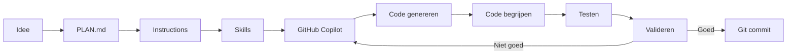

# Photography Portfolio

## Projectdoel

Een moderne portfolio-website voor een fotograaf.

De website moet in eerste instantie vooral het werk van de fotograaf tonen en bezoekers kennis laten maken met haar stijl en persoonlijkheid.

Later wordt de website uitgebreid met diensten en een reservatiesysteem voor fotoshoots.

---

## Versie 1

### Actieve pagina's

- Home
- Portfolio
- About Me
- Contact

### Under Construction

Deze pagina's worden al voorzien in de structuur, maar zijn voorlopig niet actief:

- Services
- Booking / Reservatie
- Privacy

---

## Website structuur

```mermaid
flowchart TB

    SITE["📷 Photography Portfolio"]

    SITE --> NAV["Hoofdnavigatie"]

    NAV --> HOME["Home"]
    NAV --> PORTFOLIO["Portfolio"]
    NAV --> ABOUT["About Me"]
    NAV --> CONTACT["Contact"]
    NAV --> SERVICES["Services"]

    subgraph HOME_CONTENT["Home"]
        HERO["Grote visuele foto-intro"]
        GALLERY["Masonry fotogalerij"]
        INTRO["Korte introductie fotograaf"]
        FEATURED["Uitgelicht werk"]
        SOCIAL_PREVIEW["Social media"]
    end

    HOME --> HERO
    HOME --> GALLERY
    HOME --> INTRO
    HOME --> FEATURED
    HOME --> SOCIAL_PREVIEW

    subgraph PORTFOLIO_CONTENT["Portfolio"]
        ALLPHOTOS["Portfolio-overzicht"]
        CATEGORIES["Categorieën / collecties"]
        PHOTO_DETAIL["Foto's groter bekijken"]
    end

    PORTFOLIO --> ALLPHOTOS
    PORTFOLIO --> CATEGORIES
    PORTFOLIO --> PHOTO_DETAIL

    subgraph ABOUT_CONTENT["About Me"]
        ABOUTPHOTO["Foto van fotograaf met camera"]
        STORY["Persoonlijk verhaal"]
        STYLE["Stijl & werkwijze"]
    end

    ABOUT --> ABOUTPHOTO
    ABOUT --> STORY
    ABOUT --> STYLE

    CONTACT --> SOCIALS["Social media / contactgegevens"]

    subgraph FUTURE["Under Construction"]
        SERVICES
        BOOKING["Booking / Reservatie"]
        PRIVACY["Privacy"]
    end

    SERVICES --> SHOOTS["Soorten fotoshoots"]
    SERVICES --> INFO["Beschrijving"]
    SERVICES --> PRICES["Prijs / vanafprijs"]

    SERVICES -. "Boek een fotoshoot" .-> BOOKING
    SITE -. "Footer" .-> PRIVACY
```

---

## AI development workflow

---

## Validatie van AI-code

Bij gegenereerde code controleren we altijd:

- Begrijp ik de code?
- Compileert de code?
- Werkt de code?
- Is de code veilig?
- Kan ik uitleggen wat de code doet?

---

## Security, privacy en compliance

Deze punten zijn aandachtspunten voor het ontwerp en voor latere uitbreidingen, **geen functies die automatisch gebouwd moeten worden**. Bij elke nieuwe functie beoordelen we of een punt van toepassing is. Technische uitvoeringsregels staan in `.github/instructions/security.instructions.md`.

### Vanaf versie 1

- [ ] Veilige basis: geen secrets in Git, noodzakelijke dependencies, veilige invoerverwerking en HTTPS bij publicatie.
- [ ] Fonts lokaal hosten; externe scripts, embeds en verzoeken aan derden kritisch bekijken.
- [ ] Geen analytics, tracking of session replay standaard activeren; toestemming en privacyrisico's eerst beoordelen als we ze willen toevoegen.
- [ ] Publicatierechten van foto's en herkenbare personen controleren; extra aandacht voor minderjarigen en EXIF/locatiegegevens.
- [ ] Vóór de website live gaat nagaan welke privacyinformatie, cookies- en andere verplichtingen daadwerkelijk van toepassing zijn.

### Later beoordelen bij nieuwe functionaliteit

- [ ] **Registratie/accounts:** is leeftijd relevant? Indien nodig passende leeftijds- en ouderlijke-toestemmingsregels toepassen; geen onnodige geboortedata verzamelen.
- [ ] **Contact en reservaties:** alleen noodzakelijke klantgegevens vragen, invoer server-side valideren en gegevens afschermen en gepast bewaren.
- [ ] **Nieuwsbrieven/marketingmails:** passende rechtsgrond, transparante aanmelding waar vereist en een werkende uitschrijfmogelijkheid; onderscheid met reservatiebevestigingen.
- [ ] **Online betalingen/abonnementen:** volledige prijs vooraf tonen en eventuele automatische verlenging, termijn en opzegvoorwaarden duidelijk vermelden nabij het betaalmoment.
- [ ] **Foto-uploads en beheer:** veilige bestandsvalidatie, toegangscontrole en privacy van klantfoto's.
- [ ] **DMCA/andere auteursrechtprocedures:** alleen opnieuw onderzoeken als de aard van de dienst of door gebruikers geplaatste inhoud dit relevant maakt; geen automatische US DMCA-registratie voorzien.

Controleer toepasselijke Belgische/EU-regels opnieuw wanneer de functie wordt geïmplementeerd. Een afgevinkte codecontrole is op zichzelf geen bewijs van juridische conformiteit.

---

## Toekomstige uitbreidingen

- Services voor verschillende soorten fotoshoots
- Prijzen en pakketten
- Online booking
- Beschikbare datums en tijdstippen
- Opslaan van reservaties
- Database
- E-mailbevestigingen
- Beheergedeelte voor de fotograaf