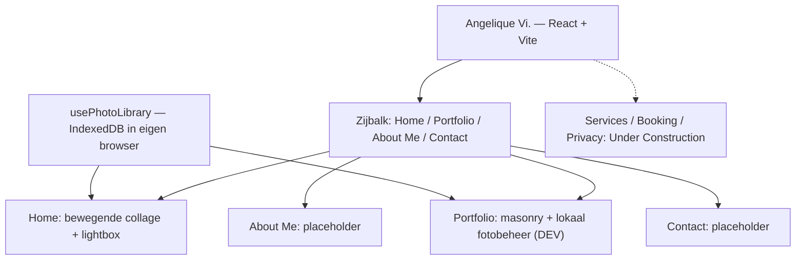
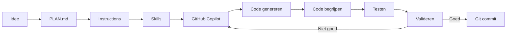

# Photography Portfolio

## Projectdoel

Een moderne portfolio-website voor een fotograaf.

De website moet in eerste instantie vooral het werk van de fotograaf tonen en bezoekers kennis laten maken met haar stijl en persoonlijkheid.

Later wordt de website uitgebreid met diensten en een reservatiesysteem voor fotoshoots.

---

## Huidige implementatie — lokaal prototype

De publiek zichtbare merknaam is **Angelique Vi.** De applicatie gebruikt React, JavaScript en Vite. **Er is nog geen ASP.NET Core-backend, SQL-database, echte adminlogin of publieke fotoservice.**

### Pagina's

- **Home** (`/`): bewegende fotocollage, pijlnavigatie en aanklikbare foto's met lightbox.
- **Portfolio** (`/portfolio`): statische masonry-galerij en **alleen in Vite-ontwikkelmodus** de lokale fotobeheerinterface. Foto's vergroten via klikken is hier momenteel **nog niet geïmplementeerd**.
- **About Me** (`/about`): voorlopig een introductie- en portretplaceholder.
- **Contact** (`/contact`): voorlopig tekst zonder echte contactgegevens.
- **Services**, **Booking** en **Privacy**: routes met Under Construction-weergave, nog geen werkende functionaliteit. De footer vermeldt dit. Socialemediaverwijzingen zijn placeholders.

### Structuur

### Huidig galeriegedrag

- Home bouwt automatisch collagekolommen uit de beschikbare foto's, met maximaal drie foto's per kolom, en herhaalt de reeks voor een doorlopende lus.
- De galerij beweegt standaard rustig naar links. De twee pijlen veroorzaken een vloeiende verschuiving van ongeveer een halve viewportbreedte en veranderen de verdere bewegingsrichting. Er is **geen** besturing met de muispositie of pauze/play-knop.
- Bij hover of toetsenbordfocus vergroot een fotokaart. De huidige code berekent de schaal op basis van de kaartgrootte (richtwaarden circa **1,35×–1,9×**, begrensd door de viewport), niet de vroegere waarden van 1,05×–1,5×.
- Aanklikken op Home opent de lightbox met vorige/volgende, toetsenbordpijlen, Escape, sluitknop en buitenklik. Tijdens de viewer of toetsenbordfocus stopt de galerijbeweging.
- Op touchapparaten en bij `prefers-reduced-motion` is de galerij horizontaal scrollbaar zonder automatische beweging.
- Bij publicatie moeten hostingroutes terugvallen op `index.html` zodat bijvoorbeeld `/portfolio` rechtstreeks geopend kan worden.

---

## Dynamisch fotobeheer — geïmplementeerd als lokaal prototype

De vroegere vaste reeks van 24 plaatsen is vervangen door **één dynamische fotocollectie** voor Home en Portfolio.

### Wat al in de code aanwezig is

- `usePhotoLibrary.js` deelt de foto's tussen beide pagina's; `photoStorage.js` bewaart originele foto-bestanden en fotogegevens in **IndexedDB van dezelfde browser**.
- `PhotoManager.jsx` verschijnt **alleen via `import.meta.env.DEV` op Portfolio** en ondersteunt meerdere foto's toevoegen, één foto vervangen of verwijderen, en alt-beschrijving aanpassen.
- Ondersteunde invoer: JPEG, PNG, WebP en AVIF tot **15 MB per bestand**. De browser leest de natuurlijke fotoverhouding; kaarten beperken extreme verhoudingen voor een bruikbare collage.
- De frontend maakt, waar mogelijk, WebP-thumbnails (maximaal 800 px breed) voor de galerij; de grote viewer gebruikt het originele bestand.
- `collageLayout.js` vormt dynamisch kolommen; Portfolio gebruikt dezelfde fotocollectie voor een masonry-overzicht.
- Als de collectie leeg is, verschijnen **12 demo-placeholders**. Het uploaden van echte foto's vervangt deze demo-weergave.
- **Geen synchronisatie, serveropslag of back-up:** foto's zijn alleen beschikbaar in die specifieke browser/opslagcontext en kunnen verloren gaan bij het wissen van browsergegevens. Foto's komen **niet** automatisch in GitHub of op een andere computer.
- De lokale knoppen zijn **geen beveiligde adminfunctie**. Er is nog geen echte login of server-side autorisatie.

### Nog controleren / verbeteren

- Handmatig testen in de browser: toevoegen (1, 5, veel), verwijderen, vervangen, refresh, lege collectie, fotovolgorde, lichtbaknavigatie, verschillende fotoverhoudingen, grote bestanden en mobiele weergave.
- Gebruiksvriendelijkheid van de bewegingspijlen, hover-zoom en compositie visueel beoordelen; build en lint bewijzen geen correct schermgedrag.
- Volledige fotoviewer ook vanaf Portfolio beschikbaar maken **als we dat willen**.
- Bij echte publicatie: geschikte alt-teksten, publicatierechten van personen, EXIF/locatiegegevens, browseropslaglimieten en performance van veel grote afbeeldingen beoordelen.
- Uitgevoerde tests bij elke wijziging expliciet benoemen; niet-geverifieerde functionaliteit niet als getest beschrijven.

### Latere fase — echte foto-administratie

Beveiligde adminlogin met ASP.NET Core, server-side rechten, duurzame afbeeldingopslag, SQL-fotometadata en veilige uploadverwerking. De huidige IndexedDB-oplossing wordt **niet** als publieke uploadbackend gebruikt.

---

## AI development workflow

---

## Validatie van AI-code

Bij gegenereerde code controleren we altijd:

- Begrijp ik de code?
- Compileert de code?
- Werkt de code?
- Is de code veilig?
- Kan ik uitleggen wat de code doet?

---

## Security, privacy en compliance

Deze punten zijn aandachtspunten voor het ontwerp en voor latere uitbreidingen, **geen functies die automatisch gebouwd moeten worden**. Bij elke nieuwe functie beoordelen we of een punt van toepassing is. Technische uitvoeringsregels staan in `.github/instructions/security.instructions.md`.

### Vanaf versie 1

- [ ] Veilige basis: geen secrets in Git, noodzakelijke dependencies, veilige invoerverwerking en HTTPS bij publicatie.
- [ ] Fonts lokaal hosten; externe scripts, embeds en verzoeken aan derden kritisch bekijken.
- [ ] Geen analytics, tracking of session replay standaard activeren; toestemming en privacyrisico's eerst beoordelen als we ze willen toevoegen.
- [ ] Publicatierechten van foto's en herkenbare personen controleren; extra aandacht voor minderjarigen en EXIF/locatiegegevens.
- [ ] Vóór de website live gaat nagaan welke privacyinformatie, cookies- en andere verplichtingen daadwerkelijk van toepassing zijn.

### Later beoordelen bij nieuwe functionaliteit

- [ ] **Registratie/accounts:** is leeftijd relevant? Indien nodig passende leeftijds- en ouderlijke-toestemmingsregels toepassen; geen onnodige geboortedata verzamelen.
- [ ] **Contact en reservaties:** alleen noodzakelijke klantgegevens vragen, invoer server-side valideren en gegevens afschermen en gepast bewaren.
- [ ] **Nieuwsbrieven/marketingmails:** passende rechtsgrond, transparante aanmelding waar vereist en een werkende uitschrijfmogelijkheid; onderscheid met reservatiebevestigingen.
- [ ] **Online betalingen/abonnementen:** volledige prijs vooraf tonen en eventuele automatische verlenging, termijn en opzegvoorwaarden duidelijk vermelden nabij het betaalmoment.
- [ ] **Foto-uploads en beheer:** veilige bestandsvalidatie, toegangscontrole en privacy van klantfoto's.
- [ ] **DMCA/andere auteursrechtprocedures:** alleen opnieuw onderzoeken als de aard van de dienst of door gebruikers geplaatste inhoud dit relevant maakt; geen automatische US DMCA-registratie voorzien.

Controleer toepasselijke Belgische/EU-regels opnieuw wanneer de functie wordt geïmplementeerd. Een afgevinkte codecontrole is op zichzelf geen bewijs van juridische conformiteit.

---

## Toekomstige uitbreidingen

- Services voor verschillende soorten fotoshoots
- Prijzen en pakketten
- Online booking
- Beschikbare datums en tijdstippen
- Opslaan van reservaties
- Database
- E-mailbevestigingen
- Beheergedeelte voor de fotograaf
- Optioneel: interactieve 3D-fotoglobe (nog niet gepland)
- Overweeg de naam Portfolio later te wijzigen naar Gallery.

