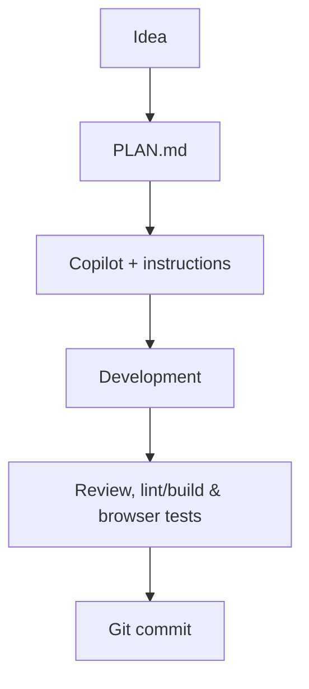

# Angelique Vi. — Photography Portfolio

A dark, photography-focused portfolio website built as a practical development project.

## Current status

- **Home:** moving photo collage with direction arrows, hover enlargement, and a full-screen lightbox.
- **Portfolio:** responsive masonry gallery and development-only local photo-management tools.
- **About Me / Contact:** existing pages with placeholder content.
- **Services / Booking / Privacy:** under construction.
- **Photos:** a dynamic collection stored in the current browser using IndexedDB. Demo placeholders appear when the collection is empty; uploaded photos are not stored on GitHub or a server.

This is a **local prototype**, not a publicly secure admin application. The React frontend exists; **C# / ASP.NET Core and SQL are planned for later**. See [PLAN.md](PLAN.md) for implemented features, validation needs, and next steps.

## Language policy

**Project code, Markdown documentation, and current website text are in English.** A visitor-facing **English/Dutch (EN / NL) selector is planned**, but has not yet been implemented. See [PLAN.md](PLAN.md).

## Technology

- React, JavaScript, Vite, and CSS
- Browser IndexedDB for local photo-management tests
- GitHub Copilot, project instructions, and agent skills under `.github/`
- Later: C# / ASP.NET Core, SQL, secure photo storage, and booking management

## Run locally

Node.js and npm are required. From the repository root:

```powershell
cd frontend
npm.cmd ci
npm.cmd run dev
```

Open the address displayed by Vite (usually `http://localhost:5173/`).

Run checks from `frontend/`:

```powershell
npm.cmd run lint
npm.cmd run build
npm.cmd audit
```

On macOS/Linux use `npm` instead of `npm.cmd`.

## Development workflow



**Important:** images added through local photo tools remain in that browser's IndexedDB. They do not synchronize to a second computer. Keep the original photographs backed up separately.

## Status

Work in progress. Not all interactions and devices have been fully tested; see open checks in [PLAN.md](PLAN.md).
