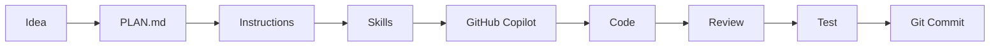

# Photography Portfolio

A modern photography portfolio website designed to showcase the work, style and personality of a photographer.

The project is being developed as a practical learning project using **C#, ASP.NET Core, React, SQL and GitHub Copilot**.

## Current Goal

The first version of the website will focus on:

- Home
- Portfolio
- About Me
- Contact
- Responsive photography presentation
- Social media integration

The following sections are planned but currently under construction:

- Services
- Booking / Reservation
- Privacy

## Technology Stack

### Backend
- C#
- ASP.NET Core

### Frontend
- React
- JavaScript

### Database
- SQL

### AI-assisted Development
- GitHub Copilot
- Markdown instructions
- Agent skills

## Development Approach

The project follows an AI-assisted development workflow:

## Future Ideas

Possible future extensions include:
- Photography categories
- Responsive image galleries
- Photoshoot services
- Online booking
- Availability management
- Customer information
- SQL database integration
- Email confirmations
- Photographer administration area
- Portfolio management
- Uploading and managing photography
- Improved booking workflow

## Status

🚧 **Work in progress**

The project is currently in the planning and Copilot configuration phase.
