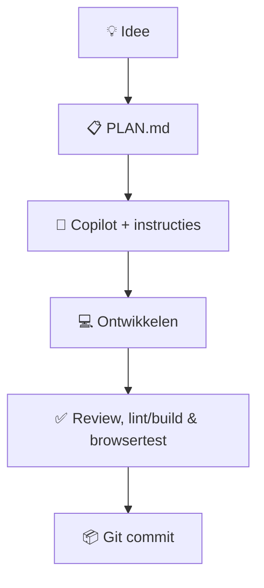

# Angelique Vi. — Photography Portfolio

Een fotografieportfolio in ontwikkeling, met een donkere, fotografiegerichte React-website.

## Huidige stand

- **Home:** automatisch bewegende fotocollage met richtingpijlen, hover en grote fotoviewer.
- **Portfolio:** responsieve masonry-galerij en in ontwikkelmodus hulpmiddelen voor lokale foto's.
- **About Me / Contact:** bestaande pagina's met tijdelijke inhoud.
- **Services / Booking / Privacy:** nog niet geïmplementeerd (Under Construction).
- **Foto's:** dynamische collectie in de browser via IndexedDB. In een lege bibliotheek verschijnen demo-placeholders. Foto's worden niet op GitHub of een server opgeslagen.

Dit is een **lokaal prototype**, geen openbare adminfunctie. De React-frontend is gebouwd; **C#/ASP.NET Core en SQL zijn toekomstig werk**. Zie [PLAN.md](PLAN.md) voor huidige functionaliteit, controles en vervolgstappen.

## Stack

- React, JavaScript, Vite en CSS
- Browser IndexedDB voor lokale fototests
- GitHub Copilot met projectinstructies onder `.github/`
- Later: C# / ASP.NET Core, SQL en beveiligd foto-/reservatiebeheer

## Lokaal starten

Node.js en npm zijn nodig. Voer vanuit de repository-hoofdmap uit:

```powershell
cd frontend
npm.cmd ci
npm.cmd run dev
```

Open het lokale adres dat Vite toont (meestal `http://localhost:5173/`).

Controles vanuit `frontend`:

```powershell
npm.cmd run lint
npm.cmd run build
npm.cmd audit
```

Op macOS/Linux kan `npm` in plaats van `npm.cmd` gebruikt worden.

## Ontwikkelworkflow



**Let op:** foto's uit de lokale beheerinterface blijven alleen in de IndexedDB-opslag van de gebruikte browser. Ze zijn niet gedeeld met je tweede computer. Bewaar originele foto's zelf apart.

## Status

🚧 Actief in ontwikkeling. Niet alle interacties en apparaten zijn volledig getest; zie de open controlepunten in [PLAN.md](PLAN.md).
